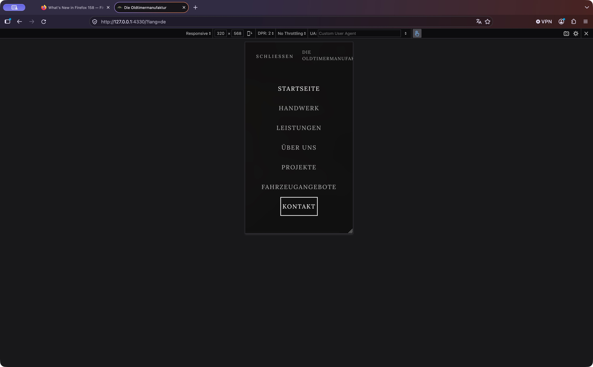
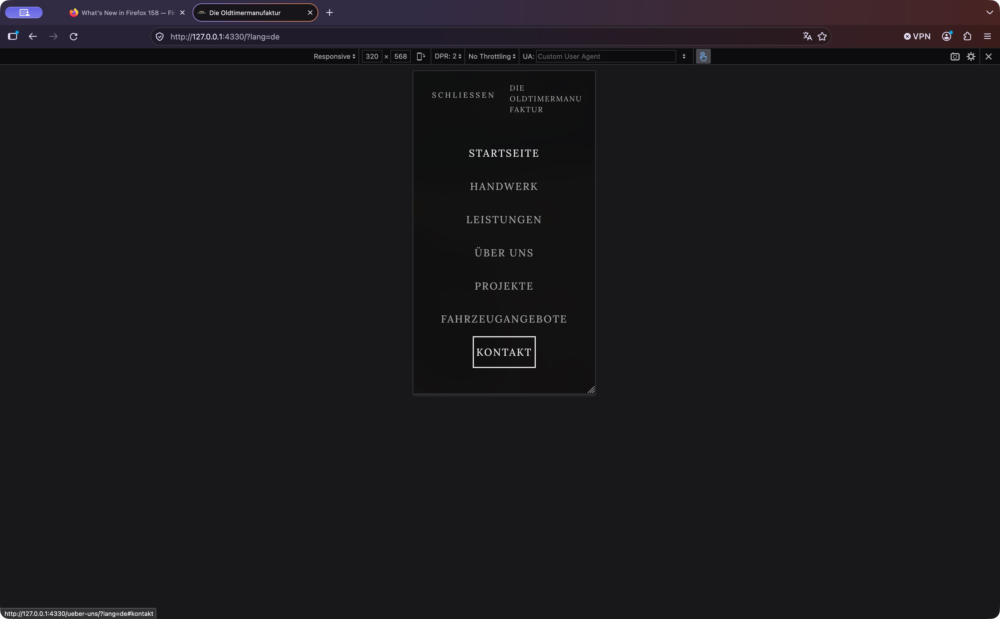
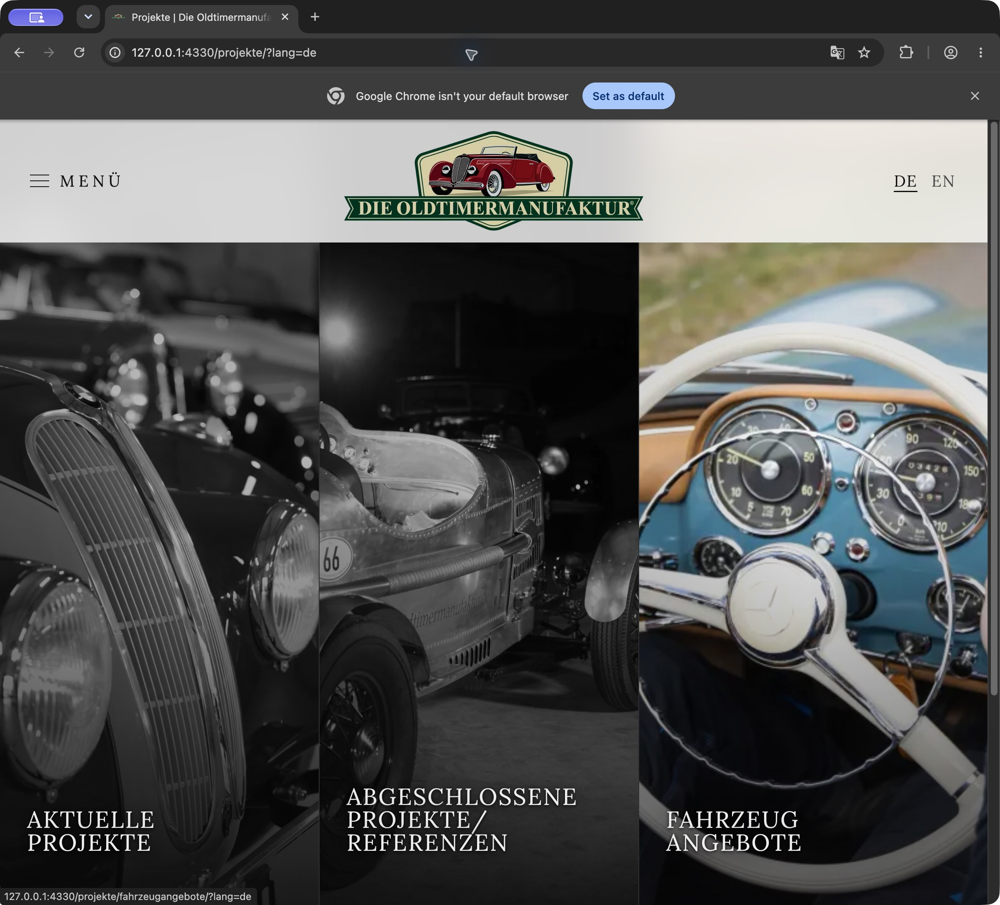
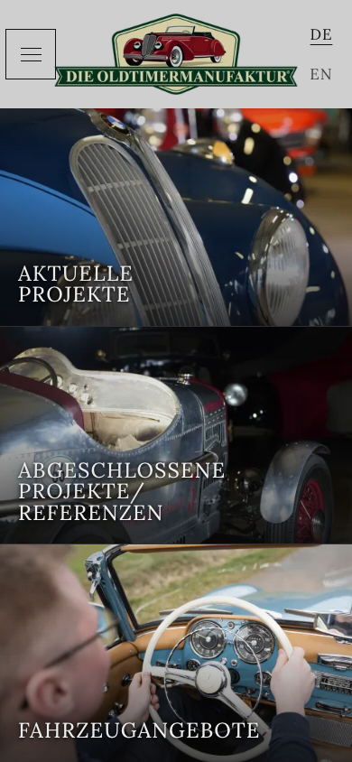

# Local pre-release browser audit — 25 October 2026

The observed defects were fixed and retested. The completed local checks pass: 12,592 browser assertions across the final automated suites, alongside the native-browser review.
This is a bounded release audit, not a claim that every possible browser version,
device, network condition or assistive technology has been tested. Nothing was
published and the existing development-preview safeguards remain active.

## Fixes

- **Narrow menu:** the company name was clipped in native Firefox at 320 × 568.
  It now wraps within the menu header. The last navigation item remains visible
  when keyboard focus moves to it. Retested in native Safari, Chrome and Firefox,
  with automated Chrome/WebKit checks at 320, 390, 844 and 1440 px.
- **Header contrast:** the language switch on the Projects page could fall below
  4.5:1 over dark photographs. Subpage headers now use a stronger translucent white
  background and stronger inactive language text, retaining their blur.
- **Visible and accessible names:** language labels now start with DE/EN. Fax and
  map links use their visible content as their names. Vehicle-card names include
  their visible category and vehicle title. Project-title fragments retain word
  boundaries in both languages, including the German compound “Fahrzeugangebote”.
- **Landmarks:** vehicle pagination has a distinct name from footer navigation;
  repeated enquiry blocks are labelled groups within the vehicle story instead
  of identically named complementary landmarks.
- **Dependencies:** compatible lockfile updates resolved five high-severity npm
  advisory groups affecting the toolchain and transitive packages. The final audit
  reports zero known vulnerabilities, 252 verified registry signatures and 71
  verified attestations. No application dependency was added for browser QA.
- **Crawler consistency:** advanced the reviewed shared modification date, explicitly
  synchronized the sitemap, updated the German LLM summary and reviewed robots.txt.
  Existing complete Open Graph and JSON-LD output remains validated; no business,
  legal, vehicle or contact facts were invented by these fixes.

Existing uncommitted work was present before this audit and was preserved. The
changes to legal questionnaires, rights documentation, photography and editorial
content that predated this run are not represented as newly approved release facts.

## Numbered flow review

| Step | Flow and exercised states | Final health |
| --- | --- | --- |
| 1 | Homepage and editorial pages: desktop/mobile layouts, DE/EN copy, section geometry, image crops, lower editorial sections, fixed header and project links | Pass in the observed layouts |
| 2 | Menu and keyboard: open/close, short viewport, focus wrap, Escape, focus return, background exclusion and narrow header label | Pass after fixes |
| 3 | Vehicle browsing: all three archives, pagination, matching and empty search, clearing, cross-category results, detail visit and Back, restoration without browser form values | Pass |
| 4 | Vehicle documentation: every vehicle in both languages at desktop/mobile widths, full image decoding, content bounds, lightbox open/Tab/Escape/focus return | Pass |
| 5 | Media: normal hero playback, pause/resume, visibility changes between homepage sections, reduced motion on arrival and during the visit, manual playback, blocked autoplay fallback, fallback pause, company-film controls and subtitle track, JavaScript-disabled links/navigation | Pass in the automated states |
| 6 | Legal and error routes: readable DE/EN templates, missing-route 404 response, noindex, home recovery, crawler links, metadata and built CSP | Pass locally; production approvals remain open |

Telephone/email/map destinations were inspected as links. No telephone call, email,
external map interaction, publication or other external communication was made.

## Browser and viewport coverage

The actual Safari, Google Chrome and Firefox apps were operated with Computer Use.
Native evidence includes desktop pages, mobile responsive views, Safari/Firefox
keyboard menu cycles, Firefox search/Back and both browsers' lightbox focus return.
Firefox was additionally retested with committed responsive inputs at 320 × 568;
its final German menu screenshot below shows the complete wrapped name and focused
Contact link.

Automated engines supplement those native checks:

| Suite | Chrome | Playwright WebKit | Scope |
| --- | --- | --- | --- |
| Template/menu matrix | 88 visits, 968 checks, zero failures | 88 visits, 968 checks, zero failures | 11 representative routes × 2 languages × 4 viewports |
| Complete vehicle matrix | 628 visits, 5,024 checks, zero failures | 628 visits, 5,024 checks, zero failures | 157 vehicles × 2 languages × desktop/mobile |
| Interaction matrix | 304 checks, zero failures | 304 checks, zero failures | Search/history, dialogs, all homepage motion sections, failure/reduced-motion states, film, no-script recovery |
| Focused homepage geometry | Pass | Pass | Four sections at four viewports in both languages |

The four automated viewports were 1440 × 900, 390 × 844, 320 × 568 and 844 × 390.
The complete vehicle matrix used 1440 × 900 and 390 × 844. Chrome automation used
`channel: 'chrome'`, the installed Google Chrome application. WebKit automation is
additional engine coverage; it is not labelled as native Safari or iOS testing.

The separate official Playwright Firefox runtime failed to start on this Mac in
both headless and visible attempts, with sandbox-extension/graphics startup errors
and a launch timeout. Its automated matrix is **not** counted as passing. The
installed Firefox app was available and used for the native checks above.

## Verification

- `npm test`: 149 passing tests, plus the vehicle-discovery fixture.
- `npm run build` and `npm run build:pages`: pass, including verification of all
  344 generated pages, 172 language pairs, 314 authored vehicle language pages,
  CSP, metadata, IDs, links, image dimensions, motion controls and crawler output.
- The static accessibility audit reports 9,936 image occurrences, 6,704 gallery
  links, no heading jumps and no failures across the generated pages.
- Rendered axe-core scan: **52 states, zero reported violations** across main
  templates, menus and lightboxes, desktop/mobile and DE/EN. Some checks remain
  indeterminate, including image-backed contrast; this is not a WCAG certification.
- `npm run security:check`: pass after the lockfile update.
- `npm run vehicles:sync`: run explicitly; sitemap diff reviewed. Canonical routes
  are unchanged; the shared reviewed modification date advances to 2026-10-25.
- Source hashes before/after the final two builds confirm no tracked source files
  were rewritten by the builds. `git diff --check` passes.

The optional QA scripts are `scripts/test-release-browsers.mjs`,
`scripts/test-release-interactions.mjs` and `scripts/test-release-accessibility.mjs`.
They use externally installed Playwright/axe-core and never publish or edit vehicle
records. Set `PLAYWRIGHT_MODULE`, `PLAYWRIGHT_BROWSERS_PATH`, and (for the axe scan)
`AXE_SOURCE`; use `BROWSER=chromium` or `BROWSER=webkit`, `SUITE=smoke` or
`SUITE=vehicles`, and optionally `SITE_URL` for the local production preview.

Full local screenshots and assertion records are under
`.codex-qa/browser-2026-10-25/` (ignored QA output). The compact committed results
are in [results-summary.json](results-summary.json). Application CSP checks are
recorded before screenshot capture because Playwright's WebKit screenshot helper
itself attempts a style injection blocked by the site's real CSP. The extended motion test uses the visible control coordinates: locator auto-scrolling otherwise moved the last short-screen section mostly out of view, correctly triggering visibility-based pause. Direct pointer and keyboard checks distinguish that harness artifact from a site playback defect.

## Accepted screenshot evidence

These are screenshots captured during this run, inspected before inclusion.

| Narrow menu before the fix — Firefox | Narrow menu after the fix — Firefox |
| --- | --- |
|  |  |

Desktop Projects in actual Chrome, after the header contrast fix:

Mobile Projects in Chrome, after the fixes:

[Native Safari desktop evidence](evidence/safari-desktop.png) is also retained.

## Remaining production acceptance work

These items were unavailable or outside the authorization to change production
facts. They must not be marked complete from the local results:

1. **Physical devices and assistive technology:** real iPhone/iPad/Android devices,
   touch gestures, browser chrome/safe areas, on-screen keyboard, VoiceOver/TalkBack,
   and other screen readers were not tested. Responsive desktop views are simulations.
2. **Final host:** actual IONOS/Apache HTTPS, DNS, HTTP status/redirect behavior,
   security/cache/compression headers, deployed assets, slow/mobile-network performance,
   and operational rollback need checking against the final deployment candidate.
   The generated `.htaccess` and 404 output pass local build verification.
3. **Release approvals:** [PRODUCTION-RELEASE-CHECKLIST.md](../../PRODUCTION-RELEASE-CHECKLIST.md)
   still records pending legal-text, company/vehicle-claim, media-rights, hosting and
   release-owner evidence. Preview labels/noindex remain enabled. This audit does
   not supply those approvals or authorize disabling the safeguards.

Recheck the actual release candidate after production flags or hosting settings change.
