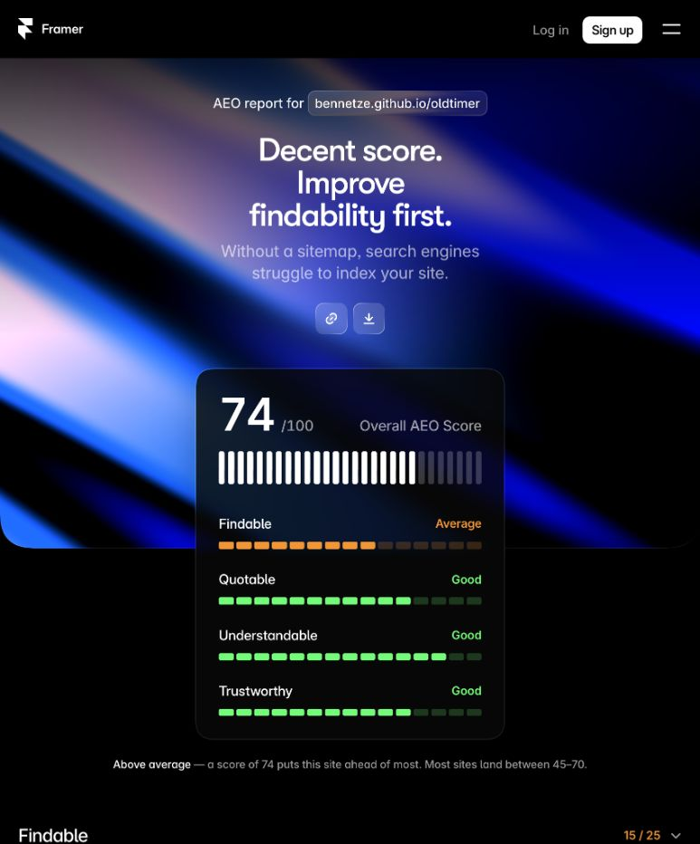

# Lighthouse and Framer AEO — 25 October 2026

Background-only improvements were published to the existing
[GitHub Pages preview](https://bennetze.github.io/oldtimer/) and retested.
Visible text, headings, imagery, videos, layout, animation and Open Graph
presentation remain unchanged. All preview pages retain `noindex`.

## Public results

Google Lighthouse 13.5.0 in headless Google Chrome, using default mobile simulated
throttling or the desktop preset. German comparisons use `?lang=de` to avoid the
documented browser-language redirect. Scores vary between runs.

| Test | Before | Final |
| --- | ---: | ---: |
| Homepage mobile performance | 95 | 99–100 across two final runs |
| Homepage desktop performance | 100 | 100 |
| Handwerk mobile performance | 95 | 98 |
| Accessibility, all tested pages/devices | 100 | 100 |
| Best practices, all tested pages/devices | 100 | 100 |
| Homepage SEO | 60 | 63 |
| Handwerk SEO | 63 | 66 |
| Framer homepage AEO | 58 | 74 |

The bare homepage was also audited before changes: performance 96, accessibility
100, best practices 100, SEO 60 after browser-language selection redirected to
English. That trace emitted a Lantern diagnostic but completed; the explicit
language comparisons above avoid that redirect.

The only failed scored SEO check in all final reports is `is-crawlable`, because
this remains a development preview. Neither that safeguard nor the release gates
were disabled to increase scores. Final runs have zero Total Blocking Time and
zero Cumulative Layout Shift.

The second final homepage mobile run measured FCP 0.92 s, LCP 1.67 s and Speed
Index 1.49 s. The other final mobile run scored 99: FCP 1.05 s, LCP 1.77 s,
Speed Index 3.38 s. These are lab observations, not field-performance guarantees.

See [baseline.json](baseline.json), [final.json](final.json), the
[baseline Framer report](https://www.framer.com/aeo/results?id=bennetze-github-io-mvo98on9)
and the [final Framer report](https://www.framer.com/aeo/results?id=bennetze-github-io-mvo9xiar).
Framer's Findable score increased from 8 to 15/25 and Understandable from 13 to
22/25. Canonical URLs now receive 7/7 and JSON-LD 9/9. Quotable remains 19/25;
Trustworthy remains 18/25. Expanded section findings were reviewed.

## Implementation

- Converted the existing full Lora variable font losslessly to WOFF2 and preload
  it from the shared layout. Size falls from 210,884 to 84,252 bytes (60% on disk;
  network savings depend on host compression). Character map, glyph order,
  metrics, variation axes, names and OS/2 data match the TTF. Every glyph outline
  was compared at weights 400, 500 and 700, with identical drawing commands.
  The original TTF and licence remain for offline-editor compatibility.
- Separated preview indexing permission from ordinary page identity. Regular
  preview pages now emit their existing canonical URLs and JSON-LD while
  retaining `noindex`. Explicit legal/error exclusions still omit both.
  This reuses the same facts and graph as production, with the active Pages base,
  stable IDs, language localization and CSP hashes. No FAQ schema, fabricated
  claims or hidden keyword content were added.
- Updated build verification to check that metadata on regular preview pages,
  while continuing to enforce noindex across Pages and the legal/error exclusions.
- Updated the manual German llms.txt background summary and recorded robots.txt
  review. Ran `vehicles:sync` explicitly: no sitemap diff. The applicable shared
  reviewed modification date was already 2026-10-25. Routes, authored content,
  original media and crawler permissions are unchanged.

The first published iteration contained font delivery only: mobile performance
99 and AEO 58. The next iteration added identity metadata and produced the final
results above. Visible changes prepared before the scope clarification were
fully reverted before any publication and are excluded from these results.

## Remaining scanner findings

Framer looks for `/sitemap.xml` and `/llms.txt` at the account-domain root. Those
URLs return 404, while the actual project files at `/oldtimer/sitemap.xml` and
`/oldtimer/llms.txt` return 200 and are linked in the HTML head. This project
cannot write the account-domain root from its Pages artifact. Its robots policy
also remains at the project path; the existing rights policy continues to exclude
training bots while permitting search and user-initiated answer-service crawlers.

Other deductions concern the intentionally sparse homepage copy, external
citations and decorative-image alt coverage. Adding visible prose, FAQs or links
would exceed the user's scope. Decorative background images retain empty alt
attributes rather than creating redundant screen-reader announcements for a
scanner score. FAQ and llms.txt checks are bonuses in Framer's methodology.

The required looping hero can affect Speed Index. GitHub Pages sets a ten-minute
cache lifetime, which the project's Apache settings cannot override. No image,
video or animation changes were made to improve those findings.

## Validation

- `npm test`: 149 passing tests plus vehicle discovery fixture. An initial
  sandbox run could not open localhost sockets; unrestricted runs passed.
- `npm run build` and `npm run build:pages`: 344 pages, 172 language pairs and
  314 vehicle language pages validated; CSP hashes, IDs, links, metadata dates,
  image dimensions, schema, canonical URLs and structural accessibility pass.
- Pages artifact: 285.1 MB, within the configured 300 MB limit.
- Nine homepage scenarios passed in dev and on the built Pages output:
  German/English at 1440×900, 390×844, 320×568 and 844×390; reduced motion,
  no horizontal overflow, font loading, muted looping autoplay, pause and no
  animated fallback downloads on successful playback.
- Exact published/built parity for readable text, headings, image/video references,
  titles, descriptions and Open Graph metadata passed on six representative
  routes, including both homepage languages, editorial, archive and vehicle
  templates. See [visible-parity.json](visible-parity.json).
- Source diffs remained unchanged during the final builds; `git diff --check`
  passes. Page routes, components, translations, configuration and source media
  match their original versions.
- Full Lighthouse JSON/HTML and responsive screenshots remain in the ignored
  `.codex-qa/lighthouse-2026-10-25/` folder. Interim local HTTP runs and runs of
  removed visible changes are not used as public before/after results.

The user authorized background-only publication to this existing preview. No
production release was performed. Contact details entered in Framer are excluded
from the retained audit evidence.
